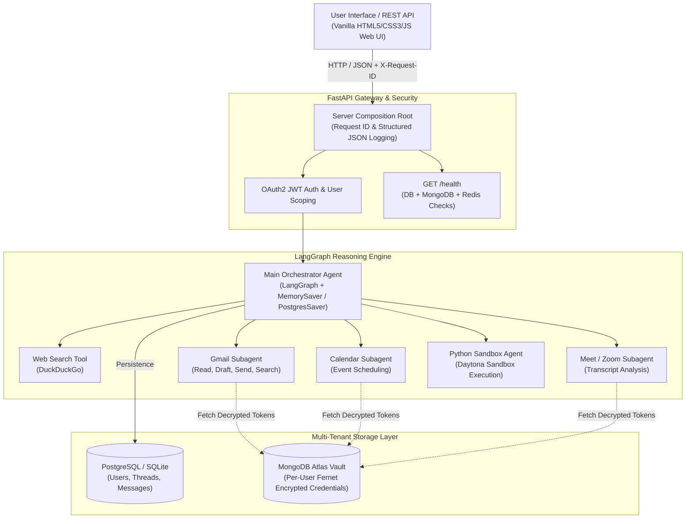

# NexusAI Central Hub — Connecting Tools and Reasoning

[](https://github.com/PrasannaMadiwar/NexusAI-Central-hub-connecting-tools-and-reasoning/actions/workflows/ci.yml)
[](LICENSE)
[](https://www.python.org/downloads/)

**NexusAI Central Hub** is a multi-tenant AI reasoning and orchestration platform built with **FastAPI** and **LangGraph**. It routes user requests to specialized subagents for Gmail automation, Google Calendar scheduling, Google Meet/Zoom transcript intelligence, real-time web search, and sandboxed Python code execution.

The system features a **Zero-Local-Fallback** multi-tenancy model: all user data, credentials, and conversation threads are strictly isolated by OAuth2 JWT claims and client-side encrypted using Fernet (AES-128-CBC + HMAC-SHA256) inside a MongoDB document vault.

---

## 🏗️ Architecture Diagram



---

## ⚡ Key Features

- **Decoupled Layered Architecture:** Strict Separation of Concerns (SRP) and Dependency Inversion Principle (DIP) across Routers, Services, and Repositories.
- **Strict Multi-Tenant Isolation:** Zero local file fallbacks. Threads, messages, and external API credentials are bound to immutable user identity claims (`sub`).
- **Encrypted Credential Vault:** User credentials (Google OAuth2 tokens, Service Accounts, Zoom S2S keys) are encrypted with Fernet AES keys before persisting to MongoDB Atlas.
- **Production Observability:** Structured JSON access logging with correlation `X-Request-ID` headers and diagnostic health checks (`GET /health`).
- **Low Footprint (<80MB RAM):** Optimized for cloud free tiers (Render, Fly.io, Railway) with an ultra-lightweight Vanilla JS frontend.

---

## 🚀 Live Demo & Deployment

- **Unique Render Target:** [https://nexusai-central-workspace-hub.onrender.com](https://nexusai-central-workspace-hub.onrender.com)
- **Deployment Documentation:** See [deploy.md](deploy.md) for full step-by-step instructions.

---

## 🛠️ Setup & Installation

### 1. Prerequisites
- **Python 3.11+**
- **Git**
- Optional: MongoDB Atlas Cluster URI and PostgreSQL (Supabase) URL for persistent production storage.

### 2. Clone the Repository
```bash
git clone https://github.com/PrasannaMadiwar/NexusAI-Central-hub-connecting-tools-and-reasoning.git
cd NexusAI-Central-hub-connecting-tools-and-reasoning
```

### 3. Create and Activate a Virtual Environment
```bash
# On Linux / macOS:
python3 -m venv venv
source venv/bin/activate

# On Windows:
python -m venv venv
venv\Scripts\activate
```

### 4. Install Dependencies
```bash
pip install --upgrade pip
pip install -r requirements.txt
pip install pytest-cov
```

### 5. Configure Environment Variables
Copy `.env.example` to `.env`:
```bash
cp .env.example .env
```

Configure your keys in `.env`:
```env
OPENAI_API_KEY=your_openai_api_key
GROQ_API_KEY=your_groq_api_key

# Database (PostgreSQL with automatic local SQLite fallback if unconfigured)
DATABASE_URL=sqlite:///./nexusai.db
SUPABASE_POSTGRES_URL=

# MongoDB Vault (Atlas or local container)
MONGO_URI=mongodb://localhost:27017
MONGO_DB_NAME=nexusai

# Encryption Key (Base64-encoded 32-byte Fernet key)
ENCRYPTION_KEY=your_fernet_base64_encryption_key
```

### 6. Run the Application
Launch the server and web interface:
```bash
python frontend.py
```
Or start via Uvicorn directly:
```bash
uvicorn nexusai.api.server:app --host 127.0.0.1 --port 8000 --reload
```
Open your browser at [http://127.0.0.1:8000](http://127.0.0.1:8000).

---

## 🧪 Automated Testing

NexusAI includes a test suite verifying authentication, multi-tenant isolation, cryptographic round-trips, and database persistence.

Run the test suite with coverage:
```bash
pytest --cov=nexusai --cov-report=term-missing
```

To enforce the CI coverage threshold (67% minimum):
```bash
pytest --cov=nexusai --cov-fail-under=67
```

---

## 📖 System Design Documentation
For an architectural deep-dive covering data flows, component responsibilities, and tradeoffs, see [docs/DESIGN.md](docs/DESIGN.md).
