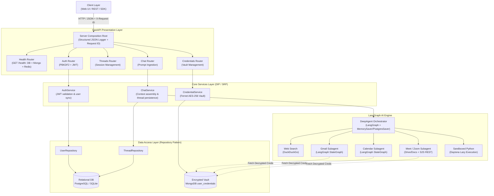

# NexusAI Architecture & System Design

A high-performance, multi-tenant AI reasoning and automation hub connecting specialized LLM agents to productivity APIs and external tool ecosystems.

---

## 1. Architecture Diagram



---

## 2. Layered Software Design

The codebase strictly enforces clean architecture, separation of concerns (SoC), and the Dependency Inversion Principle (DIP):

1. **Presentation Layer (`nexusai/api/`)**:
   - **Routers (`routers/`)**: Pure HTTP translation, parameter validation (Pydantic DTOs), status code mapping, and CORS.
   - **Middleware (`server.py`)**: Intercepts requests, attaches unique `X-Request-ID` tracking headers, calculates request latency, and emits structured JSON logs.
   - **Dependencies (`dependencies.py`)**: Injects domain services into router handlers using FastAPI's dependency injection container.
2. **Business Logic Layer (`nexusai/services/`)**:
   - **`AuthService`**: Enforces PBKDF2-HMAC-SHA256 password hashing (100,000 rounds) and validates/issues OAuth2 JWT bearer tokens.
   - **`ChatService`**: Coordinates conversational persistence, thread validation, and delegates reasoning queries to the LangGraph orchestrator.
   - **`CredentialService`**: Manages secure credential intake and vault CRUD operations.
3. **Data Access Layer (`nexusai/repositories/` & `nexusai/db/`)**:
   - **`UserRepository` & `ThreadRepository`**: Encapsulates ORM interaction using abstract repository patterns for testability.
   - **`models.py`**: SQLAlchemy schema definition (`nexus_users`, `nexus_threads`, `nexus_messages`) supporting PostgreSQL with resilient SQLite fallback.
   - **`credentials.py`**: Direct interface to MongoDB Atlas document store using client-side Fernet encryption.
4. **Execution Engine (`nexusai/engine/`)**:
   - LangGraph orchestrator delegating sub-tasks to specialized subagents (`mail`, `calendar`, `meet`, `code`).

---

## 3. Multi-Tenant Isolation Model

NexusAI implements multi-tenancy at every tier with a strict **Zero-Trust & Zero-Local-Fallback** guarantee:

1. **Identity Attribution**: All requests require an `Authorization: Bearer <JWT>` header. The subject claim (`sub`) acts as the immutable `user_id`. Frontend clients cannot override or forge this claim.
2. **Relational Data Partitioning**: All database records in `nexus_threads` and `nexus_messages` are foreign-keyed to `user_id`. Queries strictly filter `WHERE user_id = :authenticated_user_id`. Users cannot list, read, or delete threads belonging to other tenants.
3. **Cryptographic Credential Vault Isolation**: Credentials in MongoDB are stored in the `user_credentials` collection indexed on compound unique key `(user_id, service)`. User A cannot query or decrypt User B's tokens.
4. **Subagent Scoping**: Every subagent invocation carries a `RunnableConfig` containing `{"configurable": {"user_id": user_id}}`. Tools dynamically resolve credentials from the encrypted vault strictly scoped to the active tenant. Calls without a verified `user_id` fail immediately.

---

## 4. End-to-End Data Flow

```text
[1. Request]         User sends POST /api/chat with query + JWT Bearer token
[2. Identification]  Middleware generates X-Request-ID; AuthService validates JWT 'sub' claim
[3. Session Check]   ChatService loads thread history from PostgreSQL/SQLite filtered by user_id
[4. Orchestration]   LangGraph Orchestrator analyzes intent and delegates to subagent (e.g. Gmail)
[5. Vault Retrieval] Subagent requests user's 'gmail' OAuth2 token from CredentialManager
[6. Decryption]      CredentialManager decrypts token payload using Fernet key in memory
[7. Tool Execution]  Subagent queries live Gmail API using Google client library
[8. Checkpointing]   State transition saved to PostgresSaver / MemorySaver checkpointer
[9. Persistence]     User message and agent response persisted to nexus_messages
[10. Response]       Response JSON returned with X-Request-ID header; structured JSON log written
```

---

## 5. Architectural Tradeoffs

| Decision | Benefit | Tradeoff |
| :--- | :--- | :--- |
| **Fernet vs. Envelope KMS** | Zero infrastructure overhead; fast symmetric AES encryption without external KMS network latency. | Key rotation requires custom batch re-encryption script; master key must be managed via secure environment variables. |
| **Dual DB (Postgres + MongoDB)** | Relational rigor for structured chat history; flexible JSON schema for heterogeneous OAuth tokens and service accounts. | Requires maintaining two connection lifecycles and pool configurations. |
| **Resilient SQLite Fallback** | Enables instant local development and offline CI runs when remote PostgreSQL / Supabase poolers are unreachable. | SQLite lacks native horizontal scaling and does not support distributed multi-instance writes. |
| **Lazy Sandbox Loading** | Daytona sandbox instances are not spawned at application boot, keeping memory consumption < 80MB. | First code execution call experiences cold-start initialization latency. |
| **Vanilla Frontend over SPA** | Ultra-lightweight memory footprint (<80MB RAM), zero npm dependency supply-chain risks, fast free-tier deployment. | Requires manual DOM updates in client JS rather than declarative reactive component frameworks. |
